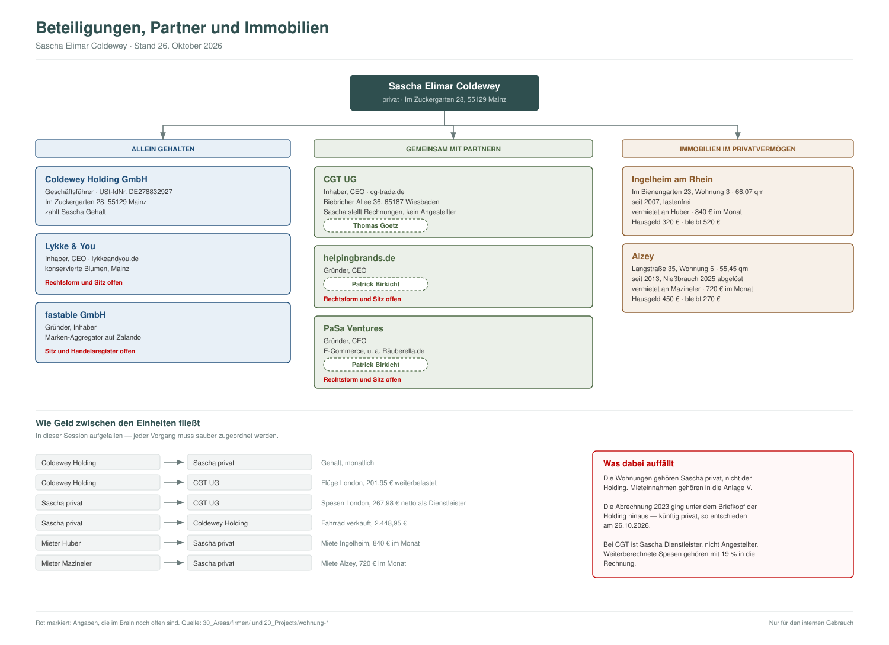

# Firmen und Beteiligungen

Je Firma ein Ordner mit `steckbrief.md`, bei Bedarf `notizen.md`.

## Übersicht

Die Zeichnung liegt als `struktur.svg` hier im Ordner und ist damit versioniert —
sie enthält keine Bankverbindungen und keine Mieterdaten über das hinaus, was
ohnehin in den Projektseiten steht. Eine druckbare Fassung erzeugt die Session
auf Zuruf.

| Firma | Rolle | Partner | Rechtsform und Sitz |
|---|---|---|---|
| [Coldewey Holding](coldewey-holding/steckbrief.md) | Geschäftsführer | — | GmbH, Mainz |
| [CGT](cgt/steckbrief.md) | Inhaber, CEO | Thomas Goetz | UG, Wiesbaden |
| [helpingbrands.de](helpingbrands/steckbrief.md) | Gründer, CEO | Patrick Birkicht | _(offen)_ |
| [PaSa Ventures](pasa-ventures/steckbrief.md) | Gründer, CEO | Patrick Birkicht | _(offen)_ |
| [Lykke & You](lykkeandyou/steckbrief.md) | Inhaber, CEO | — | _(offen)_ |
| [fastable](fastable/steckbrief.md) | Gründer, Inhaber | — | GmbH, Sitz _(offen)_ |

Die beiden Mietwohnungen gehören Sascha **privat**, nicht einer der Firmen:
[Ingelheim](../../20_Projects/wohnung-ingelheim/uebersicht.md) und
[Alzey](../../20_Projects/wohnung-alzey/uebersicht.md).

## Was beim Zeichnen auffiel

- Bei vier von sechs Firmen fehlen Rechtsform, Sitz und Handelsregister.
- Die Verflechtungen laufen quer: Die Holding zahlt Sascha Gehalt und streckt
  Reisekosten für CGT vor, Sascha stellt CGT als Dienstleister Rechnungen und
  verkauft der Holding ein Fahrrad. Jeder dieser Vorgänge braucht einen eigenen
  Beleg und die richtige Umsatzsteuerbehandlung.
- Die Abrechnung 2023 für die Wohnung Ingelheim ging unter dem Briefkopf der
  Holding hinaus, obwohl die Wohnung Privatvermögen ist. Künftig privat.
